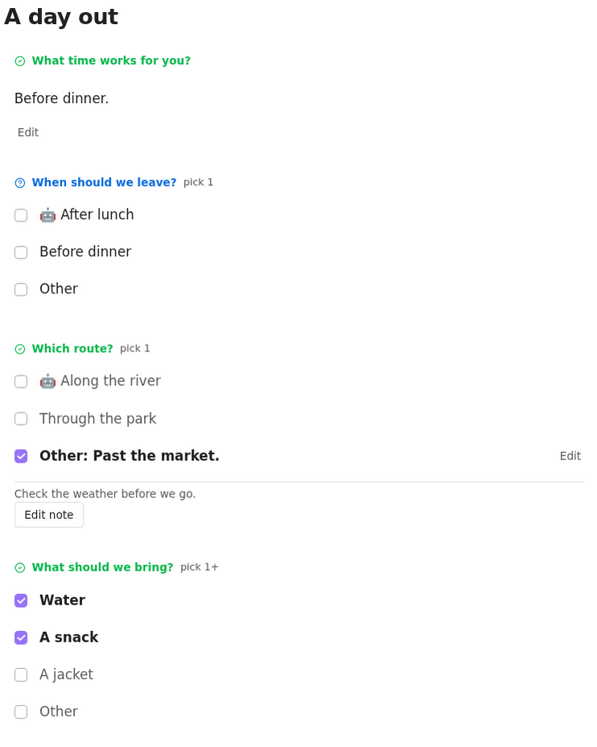

# Tincan 🥫

Answer questions right in Obsidian's reading view. Type an answer, pick an option, or leave a note. Everything stays in plain Markdown.



Write a task question, add an answer callout, and switch to reading view. Filled text answers have **Edit**; checking off the question never locks them.

## Branch prototype: question in the callout

On `question-in-callout`, you can also put a question in a standalone callout title:

```markdown
> [!question|choice] When should we leave?
>
> - [ ] 🤖 After lunch
```

The title is the question; the body holds its answer and optional nested `[!note]`. It uses the same text, pick, Other, and note controls. The task format below still works. This prototype has no separate completion checkbox and does not convert existing notes.

Open `example/vault/Question callouts.md` to try it. See the [syntax options and before/after examples](docs/format.md#prototype-question-in-the-callout) for text, single and multiple picks, Other, notes, and compatibility details. The title form is implemented; the nested wrapper alternative is a design sketch only.

## Text answers

```markdown
- [ ] What time works for you?

  > [!answer]
```

Answer… opens a blank editor, and Done saves your answer. Use Edit to change a saved answer.

## Suggested answers

Use a single pick when you have a suggestion:

```markdown
- [ ] When should we leave?

  > [!answer|choice]
  >
  > - [ ] 🤖 After lunch
```

Tick the suggestion to answer immediately, or tick Other to open the editor and save your own text. Unticking clears the saved answer. The suggestion stays visible and readable in Markdown after saving.

Suggestions use the same controls and save rules as other picks. To update the earlier text-suggestion format, change `[!answer]` to `[!answer|choice]` and `> 🤖 After lunch` to `> - [ ] 🤖 After lunch`. A plain `[!answer]` body is always literal answer text.

## Pick one

```markdown
- [ ] Which route?

  > [!answer|choice]
  >
  > - [ ] 🤖 Along the river
  > - [ ] Through the park
```

Tap an option to save it straight away. Picking another clears the first, including Other; unticking clears your answer. `🤖` marks a recommendation, and the title says “pick 1”.

## Pick more than one

```markdown
- [ ] What should we bring?

  > [!answer|choices]
  >
  > - [x] Water
  > - [ ] A snack
  > - [ ] A jacket
```

Tick any combination. Each tap saves, and the title says “pick 1+”. No Done button needed.

## Write something else

Every pick question has an Other row. Tick its checkbox to open the editor, type your answer, and press Save. In a single-pick question, saving Other clears the options, and picking an option clears Other. In a multi-pick question, Other can accompany the options.

```markdown
- [ ] How should we meet?

  > [!answer|choice]
  >
  > - [ ] In person
  > - [ ] Video call
  >
  > Other: A phone call.
```

Saved Other text reads as a checked option, with Edit beside it. Unticking it clears the custom answer.

Ticking an empty Other checkbox clears the saved option immediately and opens the editor. If you cancel, tick Other again to resume your draft. Unanswered Other rows have no separate button; saved Other text keeps Edit.

Existing `[!answer|choice]` blocks with more than one pick (including a checked option plus nonblank Other) keep their Markdown but receive no Tincan reading-view controls. Edit the source to keep one pick, or change the block to `[!answer|choices]` if multiple answers are intended.

## Leave a note

The small Add note button keeps a comment inside the same box, separate from the answer. Saved notes have an Edit note button. Both use Obsidian's native button appearance. Notes use a nested callout:

```markdown
- [ ] What should we try next?

  > [!answer]
  > A weekend workshop.
  >
  > > [!note]
  > > Ask again after checking the dates.
```

Note controls appear only when the answer already contains a nested `[!note]`. To add the first note, put an empty nested `[!note]` at the end of the answer in source view; it shows Add note in reading view. An ordinary task or an answer without that marker gets no note controls. A note never counts as an answer.

## Install

Requires Obsidian 1.13.0 or newer, on desktop or mobile.

For a manual install, build the plugin or get the three files from a release:

1. Copy `main.js`, `manifest.json`, and `styles.css` into `Vault/.obsidian/plugins/tincan/`.
2. Turn Restricted mode off under Settings → Community plugins, and enable Tincan.
3. Open a note in reading view.

For Obsidian Sync, enable syncing the installed and active community plugin lists on each device. Let syncing finish, restart the receiving app, and enable Tincan there.

## Sample vault

`example/vault` contains synthetic questions covering each kind, recommendations, Other, and notes. Build the plugin, then run:

```fish
bash example/setup-plugin.sh
```

Open `example/vault` as a vault in Obsidian, enable Tincan, and open `Questions.md` in reading view. See [the example instructions](example/README.md).

## Development

```fish
nix develop
pnpm install --frozen-lockfile
pnpm check
pnpm build
```

`pnpm dev` watches for changes. The Nix shell supplies Node, pinned pnpm, and lefthook, and configures the Git hooks. Copy or symlink only the three release files into a development vault.

## Saving and drafts

- Saves check the current question and answer before writing. Duplicate questions, concurrent changes, and editable copies in other panes refuse the save and keep the draft.
- Cancel keeps a draft in memory. Resume draft opens it again; restarting Obsidian or disabling Tincan loses unsaved drafts.
- Controls work in reading-view note panes. Code examples, embeds, and unsupported question structures stay ordinary Markdown.

See [the format and save rules](docs/format.md) for the details.

## Releases

The check workflow runs `pnpm check` on pushes to `main` and pull requests. The release workflow checks a bare version tag, such as `0.1.0`, runs the full check, attests the build, and attaches the three plugin files to a GitHub release.

`pnpm release -- patch` uses the release helper to bump versions, commit, tag, and push to remotes named `github` and `origin`. `versions.json` maps each release to its minimum Obsidian version.

License is [0BSD](LICENSE). Vendored tooling keeps its original notices.
